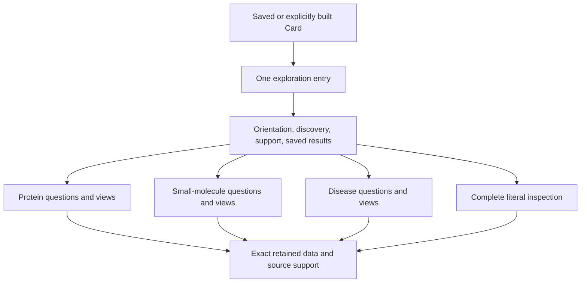

# Card exploration: detailed design proposal

## Scope and recommendation

This is the first detailed proposal under the
[human exploration plan](card_human_exploration_api.md), incorporating the
maintainer's clarification: **the scientific experience may differ by Card nature**.
Share navigation, support inspection and saved-result guarantees; design the
scientific questions, opening content, views and criteria separately for each
nature. A common `Card` implementation does not imply one scientific interface.

The recommendations below select concrete candidate interactions for review.
The catalog does not claim complete API delivery or measured usability. The v1
contract selects initial signatures; the linked scope reports identify delivered
subsets. The current SDK, schemas and published contracts remain authoritative. The
maintainer has authorized bounded implementation and clarified the separate
[human and agent access experiences](card_human_exploration_api.md#human-and-agent-access-to-the-same-knowledge)
before API integration; proposed 0.15.0 consolidation stays paused.

The [v1 contract](card_exploration_v1_contract.md) resolves the five findings from
the [pre-implementation review](#pre-implementation-review): concrete result/item
types, selection/navigation, captured cross-Card scope, inert saved reading and
the bounded first delivery. Follow that contract for the initial implementation
design; the catalogs here retain the broader scientific target. Verified public
paper walkthroughs are available. The [first protein journey](card_protein_exploration.md)
records its delivered development subset, followed by the
[nature/coverage](card_nature_exploration.md) and
[contextual-navigation](card_context_navigation.md) continuations. Broader
implementation and researcher acceptance remain separate work.

**Release requirement, 2026-10-22:** the maintainer requires this entire broad
design and the validated human experience before 0.15.0. Initial A–D delivery is
an intermediate milestone. Follow the
[completion inventory and implementation order](card_exploration_completion_0150.md);
release consolidation remains paused until that work is accepted.

Current resolution supports `protein`, `small_molecule` and `disease`; all three
receive their own design here. Future natures need their own reviewed profile.
Unknown/unrecognized Cards retain generic, complete inspection without pretending
to understand their scientific semantics. A generic fallback does not qualify a
new nature's scientific experience.

Inspection basis: the current [public resolution surface](../PUBLIC_API.md),
[Card implementation](../../sabueso/core/card.py),
[protein activity reader](../../sabueso/core/bioactivities.py),
[molecular clinical reader](../../sabueso/core/clinical.py),
[chemical-role mapping](../../sabueso/mappings/chebi.py) and
[disease resolution/deck builders](../../sabueso/tools/card/disease.py).
These establish existing behavior and the domain differences, not delivery of
the proposed exploration layer.

## Architecture of the experience



The nature determines the default scientific profile; retained content and
declared capabilities determine what can actually be shown. A profile supplies
labels, topic/question descriptors, default presentations, item granularity and
adapters to existing readers. It does not introduce another source-mapping or
scientific-rule engine. Follow [architecture](../ARCHITECTURE.md) and
[API conventions](../API_CONVENTIONS.md).

Version profile descriptors independently of scientific rules, initially proposed
as `protein_exploration@1`, `small_molecule_exploration@1` and
`disease_exploration@1`. Presentation versions do not replace the original rule
versions. Any newly derived scientific finding requires its own named/versioned
rule; the profile must not invent one implicitly through summary prose.

Select a known profile from explicit `meta.entity_type`, not a name, sequence,
formula or opportunistic field match. Missing/unsupported type selects generic
inspection and an explicit identity/type limitation. Contradictory metadata and
content remain visible; presentation does not repair identity. A related molecule
on a protein Card retains its role and source identity rather than becoming a
second subject of the protein's fields.

## Candidate public interaction contract

Recommend one additive entry, `card.explore()`, returning a read-only
`CardExplorer`. Nature-specific topics live behind that entry, rather than adding
dozens of new human-navigation methods directly to `Card` or changing current
methods' dictionary/list results. Existing direct APIs continue to work.

| Candidate call | Proposed return and behavior |
| --- | --- |
| `card.explore(related_cards=())` | `CardExplorer` bound to captured states under the v1 context rules; its default representation is the opening orientation |
| `explorer.overview()` | `CardView`: concise nature-specific orientation with links to support and next routes |
| `explorer.topics()` | `CardView`: discoverable catalog of applicable topics, display capabilities and scoped coverage |
| `explorer.questions()` | `CardView`: curated scientific questions, required inputs, answer scope and associated view routes |
| `explorer.view(topic, **options)` | `CardView`: exact named scientific view under that nature's descriptor and effective options |
| `explorer.answer(question, **options)` | `CardView`: an explicit registered question route, not free-text inference or an LLM answer |
| `explorer.search(text)` | `CardView`: local matches in retained labels, identifiers, statements and metadata, with navigable locations and matched context |
| `explorer.inspect(field_path=None, *, locator=None)` | `CardView`: full stored-root catalog, a canonical section field or a generated typed locator; field path and locator are mutually exclusive |
| `explorer.start_new()` | Explicit new live interpretation of captured Cards using installed readers; especially the saved-mode boundary, with no source acquisition |

`view` and `answer` accept stable keys discoverable from their catalogs; help shows
the supported options and defaults. Keys are scoped by profile, e.g.
`protein.structures` versus `small_molecule.chemistry`; in calls the active profile
allows the local key `structures` or `chemistry`. Persist the qualified key and
descriptor version. Do not create similarly named topics with undocumented
differences or route an unknown key by approximate name matching.

Three operations should suffice to begin: `explore()`, discover a topic/question,
then open it. More advanced operations remain discoverable through help and
autocomplete. No knowledge of pins, stores or SourceAssertion IDs is required.

### Views, items and explanations

Use consistent result behavior while preserving domain-specific item schemas:

| Candidate call | Contract |
| --- | --- |
| `view.summary()` / `view.table()` | Another presentation of the same bound semantic result; returns a `CardView`, with no scientific recomputation |
| `view.rows()` | Defensive copies of full row records with item references and units; no display truncation or lossy list-to-text conversion |
| `view.items()` | Read-only collection of labeled `CardItem` objects; selecting a display position binds the item's stable identity |
| `view.item(item_ref)` | `CardItem` in this exact result context, with readable full detail |
| `item.open()` | Show detail, or explicitly open a supported route/link, without requiring an internal reference |
| `view.filter(column, equals=value)` | A new display selection using a declared typed column; original grouping/classes/support stay fixed |
| `view.sort(column, descending=False, unit=None)` | A new display order using declared compatible types; missing values last, with explicit unit conversion for mixed compatible quantities |
| `item.explain()` | `CardView`: source-stated values, alternatives and/or derivation basis for this exact item and its effective options |
| `item.related()` | `CardView`: explicit navigable relationships and their role/support, including unavailable destinations |
| `links.follow(link_ref)` | `CardView` at a retained destination, with the origin context retained; no source fetch or latest-version lookup |
| `view.explorer` | Focal captured Card's explorer with explicit mode; null for a context-only destination without a supplied Card |
| `view.back()` / `item.back()` | The originating `CardView`; a root view returns itself with `at_root=True` |
| `view.save(path, *, overwrite=False)` | Exact self-contained v1 saved result and a save receipt; explicit overwrite, no recipe execution |

These are recommended signatures for prototype review, not existing methods.
The [v1 contract](card_exploration_v1_contract.md#1-result-item-and-presentation-model)
specifies structured rows, cell states, stable identity, capability and presentation
semantics; it takes precedence over earlier illustrative wording here.
Plain text and Jupyter use the same objects and scientific semantics. Python calls
are the initial navigation contract; HTML may offer equivalent links/controls only
where implemented. Every operation must remain available without a widget backend.

The equality filter is deliberately bounded for the initial contract. It compares
canonical column values, not translated labels or formatted/truncated cells;
missing values are reported as excluded, not interpreted as false measurements.
Quantity comparisons require a quantity and an explicit compatible conversion
basis. Compound/range/region criteria belong to separately declared topic options
until their own typed filter semantics are accepted. Reopen the underlying view
with changed scientific options to derive a new result; do not reuse display
filtering to alter thresholds or regroup experiments.

Every table declares what one row means. A row reference is issued by the view,
not a row number or a bare PDB/compound identifier. References bind the result
context as well as the original Card snapshot and stored item where applicable.
Derived groups retain their original member references and rule. Explanations
automatically retain the complete options/selection basis; users do not repeat
thresholds to explain a result.

### Capability, applicability and coverage

Keep three separate dimensions in each topic descriptor:

| Dimension | Meaning and user presentation |
| --- | --- |
| Applicability | Applicable to this nature/role, not applicable, or unknown; not a statement that a source found no records |
| Presentation capability | Specialized view available, or literal inspection available; planned scientific panels are not advertised as delivered |
| Retained knowledge/query coverage | Original per-source/area states, scope, limits and unknown denominators, using existing knowledge-state and request records |

The default catalog includes relevant areas with known gaps, not only populated
ones. A specialized view that does not yet exist must never appear as an empty
source result. For an unsupported topic key, give a useful error and available
keys; for a known topic lacking retained information, return its scoped empty/
unknown result and recorded reason. Show non-applicable topics only in an expanded
capability inspection, not as distracting empty default panels.

### Initial scientific-question routes

The following candidate keys make `questions()` and `answer()` concrete. Display
the readable question; users may copy/autocomplete the local key. Each answer
retains its question key, effective inputs and destination view descriptor.

| Profile / local question key | Readable question | Route and required scope |
| --- | --- | --- |
| Protein / `function` | What do the sources state this protein does? | `function`; retained source statements and original entity/sequence scope |
| Protein / `region_coverage` | Which retained structures represent this region? | `structures`; explicit `sequence_ref` and `region`, validated against the reader's supported canonical axis before invoking it; no inferred residue map |
| Protein / `measured_molecules` | Which molecules have measurements in this protein's context? | `bioactivities`; recorded target basis, `include_indirect` and effective `thresholds` remain explicit |
| Small molecule / `chemical_identity` | Which exact chemical entity do these records describe? | `chemistry`; retained anchor, representations and identity statements |
| Small molecule / `property_context` | What properties are retained and what is their source basis? | `properties`; source/method-specific values, alternatives and units |
| Small molecule / `measured_targets` | Which target measurements are available for this molecule? | `activity_context`; explicit retained or supplied pinned context and exact identity join; missing adapter/context is reported |
| Small molecule / `clinical_context` | What indications and studies do the sources report? | `clinical`; distinguish indications, cited trial IDs and fetched registry records |
| Disease / `meaning` | What does this disease term mean? | `definition`; source definition, scoped synonyms and term status |
| Disease / `classification` | Which equivalent and broader terms are stated? | `classification`; native ontology edges and exact supporting assertions |
| Disease / `retained_associations` | What associations are retained for this term? | `associations`; explicit source/identifier basis and supplied-context scope |

The first implementation slice need not supply every specialized route. Advertise
only registered executable routes or clearly identified literal-inspection routes,
with capability status separate from knowledge coverage. Do not populate the menu
with promised functions that silently return empty results.

## Protein experience

### Opening presentation

Order the initial content as follows, drawing only on retained supported values:

1. Source-supported name, protein nature, organism and identifying record;
   immediately visible identity ambiguity or sequence-scope limitations.
2. A concise function description and sequence context, with source attribution.
   If the source does not state function, say so without inferring it from a name.
3. Available knowledge areas: sequence/features, structures, sites/interfaces,
   measured molecule relationships, biological associations and literature.
4. Consequential gaps/conflicts and saved-state/source revision context.
5. Suggested entry routes: understand function; inspect sequence/features; explore
   structural options; inspect measured activities and assay context.

The initial screen is a biological orientation. Detailed acquisition logs,
technical identifiers and full assertion records remain one explicit drill-down
away from their associated value, without dominating the introduction.

### Scientific topics and questions

| Topic key / readable label | Main unit and default presentation | Question routes and important context |
| --- | --- | --- |
| `function` / Function and biological context | Source statement, with attributed text and typed associations | What do sources state this protein does? Preserve organism/isoform scope; associations do not become causal claims |
| `sequence` / Sequence and annotated regions | One explicit sequence axis with positional tracks and source annotations | Which residues/regions are annotated? Keep accession, version/isoform, numbering and unplaced annotations visible |
| `structures` / Experimental structures | Existing inventory item/group, expandable to entry, assembly, chain and instance | Which retained structures represent the region I specify? Show sequence state, missing coordinates, experimental context and group basis |
| `predicted_structures` / Predicted models | Source model/version, separate from experimental structures | Which predictions are retained? Keep provider metrics and their scales distinct; no inferred equivalent experimental quality |
| `sites` / Sites and molecular contacts | Annotated site or retained contact instance, with its coordinate/sequence axis | What contacts overlap source-annotated sites? Preserve the existing overlap rule and numbering limitations; no new pocket calculation |
| `variants` / Variants and isoform context | Source variant/isoform record with its declared sequence or genomic scope | Which changes and tissue-context statements are retained? Preserve assembly, transcript/isoform correspondence, per-tissue gaps and original versioned rules |
| `comparative_context` / Related proteins and comparisons | Source-stated orthology/cluster/strain relationship, or an explicit comparison with supplied Card context | What relationships or differences are recorded? Similarity/clustering does not merge identity; coordinate correspondence needs an explicit supported map |
| `bioactivities` / Molecules and measured activities | Existing molecule summary and separately labeled measurement/group/assay drill-down | Which molecules have retained measurements for this protein, on what target basis and in what conditions? No silent assay comparability |
| `associations` / Biological associations | Source relationship with its type, subject, object and qualifiers | Which disease/pathway/interaction statements are retained? Preserve association versus identity and source channel |

Reuse `structures`, `predicted_structures`, `bioactivities`, residue/site/interface
readers and their original explanation/rule mechanisms. Do not redefine activity
classes, experimental groups, annotated overlaps or sequence correspondence in
the profile. The v1 contract maps the initial adapters; other catalog topics still
need their implementation coverage mapping. A topic with only literal access
must say so.

### Signature walkthrough

The following is proposed interaction, not executable current SDK code. `protein`
is an already loaded public TcTIM Card. Names below are candidate question keys;
references come from the returned rows, never from inventing an identifier.

```python
p = protein.explore()  # biological orientation
p.questions()  # readable questions and required inputs
structures = p.view("structures")
selected = structures.filter("structure_ref", equals="pdb:1SUX")
selected.table()
if len(selected.items()):
    structure = selected.items()[0]  # visible selection, stable identity retained
    structure.open()
    structure.explain()
    structure.related()
selected.back()  # original inventory and selection context
```

If a region is requested, the question route prompts for an explicitly identified
sequence/region using the existing topic contract. It must not assume another
Card's residue numbers refer to the same positions. A missing molecular Card may
still have readable ligand-instance context here; the explorer does not acquire
the molecule or assume its complete pharmacology.

If an explicitly supplied molecule Card is the destination, its opening uses the
small-molecule profile, and `destination.explorer.view("chemistry")` continues
there. Show the originating structural/measurement relationship so the researcher
understands why that molecule is in context. Returning restores the protein view;
no protein topic or criterion is silently imposed on the molecule.

## Small-molecule experience

### Opening presentation

1. Source-supported compound label, chemical identity anchor and the retained
   molecular representation, if available; identity ambiguities are prominent.
2. A compact chemical description from retained formula/structure/properties,
   with original source, method and units reachable for every value.
3. Available areas: chemical identity, properties, retained target/activity context,
   source-stated indications/trials and literature.
4. Consequential gaps: absent property measurements, unqueried target scope,
   unavailable assay context or missing registry responses, with their own reasons.
5. Suggested routes: understand chemical identity; inspect properties; examine
   target/measurement context; inspect what sources state about clinical studies.

A structure drawing is optional presentation of an identified retained chemical
representation, with its basis stated. Do not invent coordinates, conformers,
stereochemistry, tautomer/protonation states or new descriptors. A missing renderer
must leave the original representation readable. Drug status and biological role
are shown only with the source context that supports them.

### Scientific topics and questions

| Topic key / readable label | Main unit and default presentation | Question routes and important context |
| --- | --- | --- |
| `chemistry` / Chemical identity and representation | One anchored chemical entity, representations and source identity relationships | Which exact chemical entity do these records describe? Preserve stereochemical/charge/parent information where retained; related salts/parents are not automatically the same entity |
| `properties` / Physicochemical properties | One source property assertion, with selected value and alternatives | What properties are retained and how were they obtained? Distinguish source-reported calculated versus measured values and unknown methods |
| `classification` / Chemical classes and source-stated roles | Source class/role statement, with direct/inherited basis where retained | How do sources describe this compound? A chemical class or assigned role does not establish a target-specific activity or therapeutic effect |
| `activity_context` / Targets, measurements and assay context | Explicit retained molecule–target relationship, then measurement/group/assay | What measurements concern this molecule and which targets? Preserve target assignment, conditions, units and exact matched chemical identity; no automatic selectivity claim |
| `clinical` / Indications and clinical studies | Separate indication statement, cited trial and fetched trial record | What do the sources report? Keep phase/status source-specific; a cited-but-unretrieved trial is not an empty registry result or evidence of efficacy |

Protein `bioactivities` and molecule `activity_context` intentionally differ.
The existing bioactivity reader is protein-centered; a molecule Card may lack
those measurements entirely. The profile must not call it on a molecule and
interpret an empty result as absence of activity. Use retained relationships or
explicitly attached, pinned Cards with a declared identity join; report any missing
reader/join capability separately from source knowledge. Reuse `clinical()` for
its existing indication/trial semantics and the literal inspector for unadapted
chemical fields. Reserved ADMET/pharmacovigilance schema areas are not delivered
scientific views merely because their field names exist.

Chemical classes/roles reuse the retained ChEBI declarations and their native
direct/inherited qualifiers; they do not infer a new pharmacological role. This
profile must serve biochemical probes, substrates, cofactors and other retained
small molecules as well as drug-oriented examples, without presuming a drug status.

### Signature walkthrough

`molecule` is an already loaded public example such as the existing benznidazole
Card. These calls specify proposed interactions; no source facts or counts are
asserted by this schematic transcript.

```python
m = molecule.explore()  # chemical orientation
m.view("chemistry")  # exact identity and representations
properties = m.view("properties")
selected = properties.filter("label", equals="Molecular weight")
if len(selected.items()):
    weight = selected.items()[0]
    weight.open()
    weight.explain()  # selected/alternative source values
```

An activity question without retained target context returns a scoped explanation:
which Card/context was inspected, what was not queried/retained and which explicit
acquisition or supplied-context step would be needed. No network is triggered.
It must not show “no targets” or “inactive.”
Clinical/activity topics remain part of the broader profile design; the initial
rich adapters are chemistry/properties, with other retained information reachable
through literal/source inspection rather than advertised as implemented panels.

## Disease experience

### Opening presentation

1. Source-supported disease term, ontology identifier, definition and term status.
2. Stated equivalences, related identifiers and hierarchy, clearly distinguished.
3. Available retained association and bibliography context, with its exact scope.
4. Obsolescence, ambiguous mappings and absent/unqueried association coverage.
5. Suggested routes: understand the definition; inspect classification; trace
   an equivalence; inspect retained association support.

This is a source knowledge/ontology experience. It does not give patient-specific
diagnosis, clinical recommendations or inferred target validity.

| Topic key / readable label | Main unit and default presentation | Question routes and important context |
| --- | --- | --- |
| `definition` / Definition and terminology | Source definition, scoped synonyms and term status | What entity does this term denote? Preserve synonym scope and source release |
| `classification` / Classification and related terms | Explicit ontology edge/path with its supporting assertions | Which broader terms or equivalents are stated? Equivalence, related xref and subclass remain different relationships |
| `associations` / Retained molecular and clinical associations | Source association with subject/object direction and original context | What associations are retained for this term? State the source/identifier matching basis and do not promote association to mechanism or treatment efficacy |

An ordinary MONDO-backed disease Card principally retains identity, definition and
hierarchy. Existing disease-to-target/drug deck builders can acquire other Cards;
they are not offline view adapters and must not run during exploration. Likewise,
the protein Card's `diseases()` grouping is not a general disease-Card reader.
Cross-Card association access needs explicit supplied context and separate coverage.

```python
d = disease.explore()  # ontology-oriented opening
d.view("definition")
hierarchy = d.view("classification")
selected = hierarchy.filter("object_ref", equals="mondo:MONDO:0002908")
if len(selected.items()):
    edge = selected.items()[0]
    edge.explain()
    targets = edge.related().filter("role", equals="object")
    if len(targets.items()):
        target = targets.items()[0].open()
        target.back()
```

## Shared source, context and complete-access contracts

Each profile also exposes `identity`, `sources`, `coverage`, `literature` and
`content` where applicable. Scientific labels and first-screen emphasis differ;
support inspection and full reachability do not. Literature retains the role of
each publication, not simply a list assumed to support every statement.

Recommend an optional `card.explore(related_cards=[...])` for already supplied
context. Capture all their snapshots explicitly; do not read a store's latest
revision or fetch missing Cards. State which view uses which Card and relationship
direction. Additional context never silently enriches the root Card or establishes
identity. Ambiguous matches remain unresolved. Reaching a molecule's activity
context through a protein Card must preserve both original pins and the join basis.

Generic inspection starts at the full stored root, including `sections`, assertion
and relationship stores, entities, quality, selection rules, meta, quantity seals
and preserved unknown content. Known scientific nodes receive documented labels;
unrecognized semantics remain literal and visibly unknown. Complete data access
must survive a missing specialized profile panel.

Keep frozen dot-separated section paths. For general nested inspection, issue
snapshot-bound locators composed of literal dictionary keys, stable record IDs
and indices only for ordered lists. Keys containing dots are literal keys in this
locator, not new canonical field paths. Assertion/relationship stores use IDs,
not array indices: their canonical snapshot hashing intentionally ignores order.
This is a local locator proposal, not a change to shared MOLI pin syntax.

## Opening layout, language and cost

Use one recognizable layout with nature-specific content: identity header;
short attributed orientation; relevant topic catalog; consequential scope/gap
notice; and a few scientific next actions. Topic labels show the domain concepts
above, not internal field names. Technical “SourceAssertion,” “pin” and “store”
remain available in advanced detail rather than prerequisites for ordinary use.

The prototype must show the exact calls and text/HTML layout for each nature.
For draft layouts use `<retained value>`, `<known scoped count>` and
`<recorded limitation>` placeholders; these are design placeholders, not claimed
results. Replace them with verified public saved inputs before researcher testing.
First-screen counts distinguish items from measurements, groups and records;
never display a fabricated global coverage percentage.

Recommend showing at most five initial next actions and ten preview rows, with
displayed/retained counts and an explicit route to all remaining data. These are
prototype defaults to test, not measured optimal limits. Repr/HTML rendering must
not materialize all expensive scientific topics. Card capture has a separate
visible one-time cost; printing a captured explorer is bounded and source-free.
Sorting/filtering large views must disclose actual local work where material;
performance budgets require declared public workloads and measurements.

## Snapshot and saved-result recommendation

At `explore()` creation, capture `Card.to_dict()` once, verify quantity integrity
and bind its existing snapshot identity. Existing view engines read that captured
state; the live mutable Card is not referenced for later scientific values. Share
one captured state among related views/items rather than copying it per row.
Adding related Cards creates an explicit new exploration scope.

A minimally constructed Card without `card_id` still supports generic inspection;
state that identity is unavailable and bind local locations to its snapshot.
Do not invent a global identity or fabricate a normal pinned entity reference.
Domain operations needing a resolved subject report that missing prerequisite.

Recommend `view.save(path)` as a self-contained local bundle: exact original
result/presentations, effective options and rules, all contributing Card snapshots,
support references, descriptor version and payload digests. State clearly that this
includes whole contributing Cards, beyond the visible table. No source response
archive, article or runtime sidecar is implied unless separately bound and included
explicitly. Preserving attribution is distinct from creating new execution credit.

Recommend a separate `sabueso.read_exploration(path, expected_digest=None)` returning the inert saved
`CardView`, validating original payloads and bindings without executing scientific
readers or queries. Editing and rehashing a displayed criterion must not establish
agreement with the original inputs. Reuse existing independent-reader/integrity
mechanisms and retain original rule/format versions. The
[v1 saved contract](card_exploration_v1_contract.md#4-saved-results-and-explicit-new-exploration)
defines the component-local bundle, owner quantity codecs, retained capabilities,
validation and explicit new-interpretation boundary. This is not a shared MOLI
archive standard.

Query recipes and their re-execution are a later explicit contract; initial saved
reading must not double as silent refresh. Rows/dataframe/CSV conversion is a
separate convenience export with documented context losses and units preserved;
it must not be described as a complete saved exploration.

## Decision assistance and acceptance

The intended exceptional experience is practical: the researcher quickly finds
the relevant information, understands its scope, follows its support, compares
options under explicit criteria and can recover the exact result later. Evaluate
that work directly; an attractive representation or a larger menu is insufficient.

| Nature | Researcher task | Required demonstrated outcome |
| --- | --- | --- |
| Protein | Explore a public TcTIM Card and inspect structural coverage plus one ligand/activity/source route | Correct identity/axis, declared row granularity, preserved context across topics and an explained missing join where applicable |
| Small molecule | Inspect a public benznidazole/BTS Card's identity, one property and clinical/activity scope | Chemical identity is understood; source property basis and unqueried target/trial scope are distinguished; no false activity/efficacy conclusion |
| Disease | Inspect a public MONDO Card's definition, one hierarchy/equivalence relation and available associations | Equivalence versus related/subclass is understood; offline term scope is not mistaken for acquired target/drug knowledge |
| Unknown/future nature | Open a Card with technical/extension content and no specialized profile | All retained values remain reachable; unsupported scientific interpretation is explicit |

For each supported nature, prepare exact proposed calls/responses, a full
source-tracing route, a cross-topic route, a consequential conflict/unknown, an
empty/filter-recovery route and a saved-result reopening after live-Card change.
Exercise these with researchers unfamiliar with Sabueso, without developer coaching
and with declared Python familiarity. Record task success, misinterpretations,
help/navigation needs and local time/memory. Set acceptance budgets from those
workloads, and revise the default presentation accordingly. Do not claim a positive
researcher response before those exercises occur.

Technical acceptance includes profile/adapter wiring, complete retained-node
reachability, source/direction/identity integrity, original units, immutable result
context, display-only filtering, offline traversal, inert saved reading and old SDK
compatibility. Source absence, unsupported presentation and non-applicability must
have distinct tests. Run applicable gates under [TESTS.md](../TESTS.md) when code
is authorized; this document does not qualify an implementation.

## Design decisions for review and remaining work

Recommended now: one additive explorer entry; a common interaction contract with
distinct nature profiles; scientific options owned by topic adapters; complete
literal fallback; captured snapshot context; explicit supplied related Cards;
and self-contained inert saved results. Retain existing APIs and scientific rules.

The v1 contract now selects the vocabulary/return behavior, maps the initial
adapters, specifies saved/cross-Card behavior and provides public paper walkthroughs
with [verified input facts](card_exploration_design_inputs.json). Interactive
implementation, conformance/integrity tests, cost measurements and researcher
validation remain open. The domain catalogs here are broader design targets,
not a claim that every specialized adapter already exists.

This detailed proposal resolves the direction of the nature-specific design for
review; it does not close #148 or human acceptance. Keep foundational development,
scientific usefulness and consumer-owned coordination connected under #112.

## Pre-implementation review

The review recorded on 2026-10-21 identified five operational gaps. Its original
findings remain available in the
[review checkpoint](https://github.com/uibcdf/sabueso/blob/efe07a3/devguide/pending_proposals/card_exploration_detailed_design.md#pre-implementation-review)
and #148. At the maintainer's request they are now resolved at design level by the
[v1 contract](card_exploration_v1_contract.md); they are not outstanding requests
to redesign the architecture.

| Original finding | Current design resolution |
| --- | --- |
| Result/item shape and row grain | Typed result/item/cell model, separate presentation identity, structured rows and explicit initial adapter grains |
| Selection and navigation | Labeled item collections, `open()`, complete public selections, fixed root/back and context-only behavior |
| Cross-Card scope and unavailable states | Exact captured pins, deterministic revision/ambiguity rules, supported identity basis, operation outcomes separate from source coverage and complete typed literal traversal |
| Saved result versus new computation | Versioned local bundle, original explanation closure, explicit saved capabilities, inert reading and `start_new()` boundary |
| First delivery and actual user routes | Slices A–D, bounded initial adapters, source-verified public paper walkthroughs and explicit remaining technical/human acceptance |

This closes the design choices requested by the review, not implementation or
usability acceptance. The next work is review of the concrete v1 interactions,
followed by the authorized bounded implementation and its conformance, cost and
researcher checks. Additional specialized panels remain part of the broader
profile roadmap; complete retained-content access is required from the first slice.
